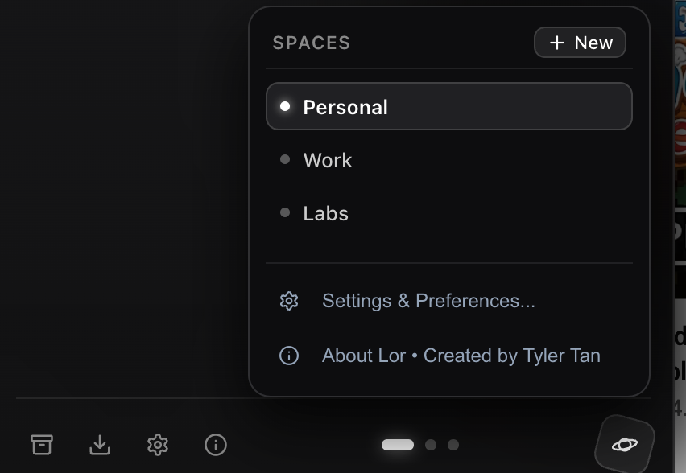

# Lor Browser 🪐

<div align="center">



**A minimalist desktop browser built with Electron, TypeScript, and React combining spaces & vertical tabs with a pure liquid monochrome aesthetic.**

[](LICENSE)
[-black.svg)](https://github.com/tylertzm/lor-browser/releases)
[](https://github.com/tylertzm/lor-browser/releases/tag/v0.1.0)
[](https://tylertzm.github.io/lor-browser/)

[**Website & Download**](https://tylertzm.github.io/lor-browser/) • [**Download DMG (v0.1.0)**](https://github.com/tylertzm/lor-browser/releases/download/v0.1.0/Lor-0.1.0-arm64.dmg) • [**Report an Issue**](https://github.com/tylertzm/lor-browser/issues)

</div>

---

## 🌟 Key Features

1. **Pure Liquid Monochrome Aesthetic**:
   - Deep pitch black (`#000000`), carbon glass panels (`#0a0a0c`), crisp white typography (`#ffffff`), and silver accents (`#8c8c8c`).
   - High-contrast, zero-clutter visual hierarchy engineered for focus.

2. **Collapsible Sidebar with 15% Screen Peek**:
   - Press **`Cmd + S`** or click **`[|]`** to collapse the sidebar into full immersion mode.
   - **Hover to Peek**: Hover your cursor within the **left 15% edge of your display** to slide the navigation bar open instantly.
   - Click the toggle button while peeking to lock it permanently in place.

3. **Dynamic Spaces**:
   - Organize context into distinct workspaces (`Personal`, `Work`, `Labs`).
   - Switch between them with trackpad gestures (two-finger horizontal swipe).
   - Rename and organize spaces in real-time with automatic persistence.

4. **Semantic Tab Tidy**:
   - Clean up tab chaos with one click. Intelligently clusters open tabs into categorized buckets:
     - `DEV & TECH` (GitHub, StackOverflow, Docs, Claude)
     - `RESEARCH & DOCS` (ArXiv, Wikipedia, OWASP)
     - `COMMUNICATIONS` (Proton, Slack, LinkedIn, Discord)
     - `MEDIA & VIDEO` (YouTube, Twitch, Streaming)
     - `GENERAL`
   - Automatically deduplicates redundant tabs.

5. **Pinned Tab Anchors**:
   - Hover over any tab and click the **`📌`** pin icon to anchor it to the top of your space.
   - Quick **`+ Pin Current`** button to anchor your active working tab immediately.

6. **Live Inline Omnibar**:
   - Press **`Cmd + L`** to enter addresses or queries directly in place.
   - One-click clean URL copying with instant visual confirmation.

---

## 📥 Download & Installation

### Option 1: Direct DMG (Recommended)
Download the latest packaged installer for Apple Silicon (M1/M2/M3/M4):
👉 **[Download Lor-0.1.0-arm64.dmg](https://github.com/tylertzm/lor-browser/releases/download/v0.1.0/Lor-0.1.0-arm64.dmg)**

1. Open the downloaded `.dmg` file.
2. Drag `Lor.app` into your **Applications** folder.
3. Open Lor from Applications or Spotlight.

> **Note for macOS Gatekeeper:**
> Because this is a community open-source release without an Apple Developer ID signature, macOS may show a security notice on first launch. If you see *"Lor is damaged or can't be opened"*, run this single command in Terminal:
> ```bash
> xattr -cr /Applications/Lor.app
> ```

---

## ⌨️ Shortcuts & Gestures

| Shortcut / Gesture | Action |
| :--- | :--- |
| **Move cursor to left 15% edge** | **Peek / Reveal Collapsed Sidebar** |
| **Two-finger horizontal swipe** | **Swipe between Spaces** |
| `Cmd + S` | Toggle / Lock Sidebar |
| `Cmd + T` | New Tab |
| `Cmd + L` | Focus Live Address Bar / Omnibar |
| `Cmd + W` | Close Active Tab |
| `Cmd + [` / `Cmd + ]` | Navigate Back / Forward |
| `Cmd + R` | Reload Current Page |

---

## 🛠️ Building from Source

### Prerequisites
- [Node.js](https://nodejs.org/) (v18+)
- [npm](https://www.npmjs.com/) (v9+)
- macOS (tested on Sonoma & Sequoia)

### Steps

```bash
# 1. Clone the repository
git clone https://github.com/tylertzm/lor-browser.git
cd lor-browser

# 2. Install dependencies
npm install

# 3. Start development server
npm run dev

# 4. Package native macOS .dmg
npm run package
```
The packaged DMG will be generated inside the `dist/` directory.

---

## 🧑‍💻 Creator Spotlight

Conceived, designed, and engineered with obsession by **Tyler Tan**.

- **GitHub**: [@tylertzm](https://github.com/tylertzm)

---

## 📄 License

This project is licensed under the [MIT License](LICENSE).
