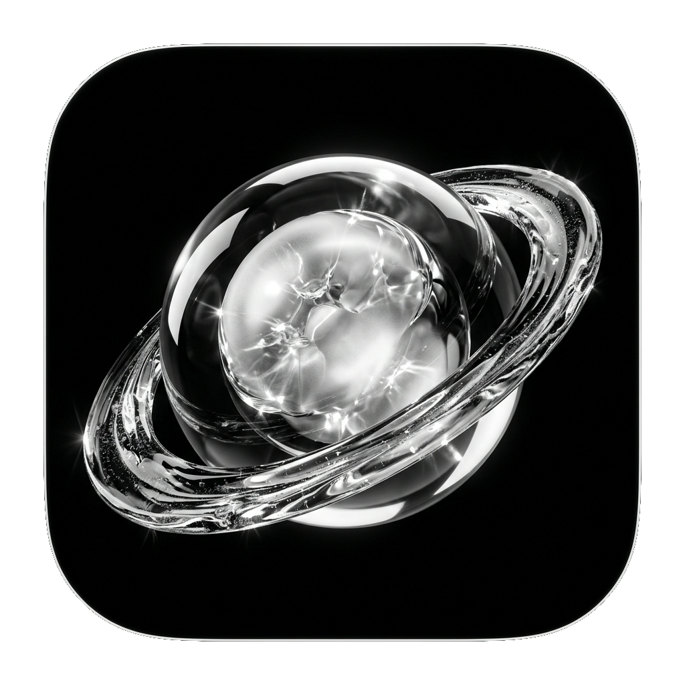
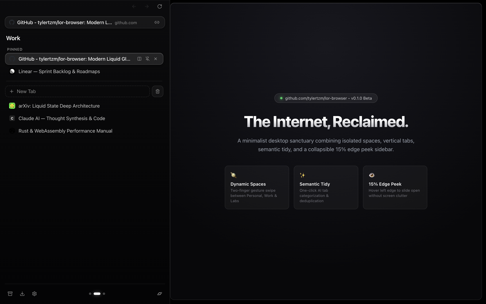
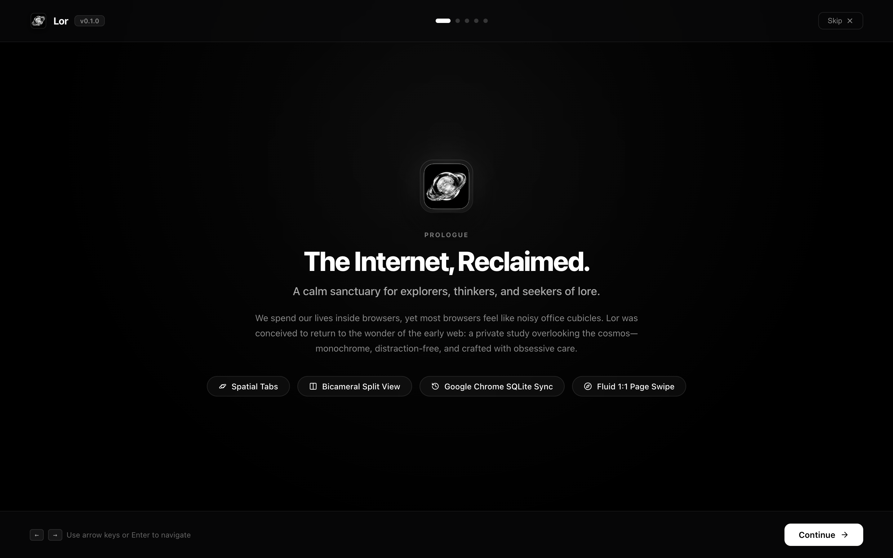

# Lor Browser 🪐

<div align="center">

<br>



# Lor
### Modern Liquid Glass & Monochrome Browser for macOS

A minimalist desktop browser built with Electron, TypeScript, and React combining spaces & vertical tabs with a pure monochrome aesthetic.

<br>

[-ffffff?style=for-the-badge&logo=apple&logoColor=black)](https://github.com/tylertzm/lor-browser/releases/download/v0.1.0/Lor-0.1.0-arm64.dmg)
[](https://github.com/tylertzm/lor-browser/releases/tag/v0.1.0)
[](https://tylertzm.github.io/lor-browser/)

<br>

[**Website**](https://tylertzm.github.io/lor-browser/) • [**Direct Download (.dmg)**](https://github.com/tylertzm/lor-browser/releases/download/v0.1.0/Lor-0.1.0-arm64.dmg) • [**GitHub Releases**](https://github.com/tylertzm/lor-browser/releases) • [**Report Bug**](https://github.com/tylertzm/lor-browser/issues)

<br>



</div>

---

## 🌟 Key Highlights

<div align="center">

| Prologue | Spaces & Navigation |
| :---: | :---: |
|  |  |

</div>

1. **Pure Liquid Monochrome Canvas**:
   - Deep obsidian canvas (`#000000`), carbon panels (`#0a0a0c`), crisp white typography (`#ffffff`), and silver accents.
   - High-contrast, zero-clutter visual hierarchy engineered for deep focus.

2. **Collapsible Sidebar with 15% Screen Peek**:
   - Press **`Cmd + S`** or click **`[|]`** to collapse the sidebar into borderless web immersion.
   - **Hover to Peek**: Move your cursor within the **left 15% edge of your display** to slide the navigation bar open instantly.
   - Click the lock toggle button while peeking to pin it permanently open.

3. **Dynamic Isolated Spaces**:
   - Organize workflows into distinct workspaces (`Personal`, `Work`, `Labs`).
   - Switch between them with smooth trackpad gestures (two-finger horizontal swipe).
   - Real-time space management and local persistence.

4. **Semantic Tab Tidy**:
   - Clean up tab chaos with one click. Intelligently clusters open tabs into categorized buckets:
     - `DEV & TECH` (GitHub, StackOverflow, Docs, Claude)
     - `RESEARCH & DOCS` (ArXiv, Wikipedia, OWASP)
     - `COMMUNICATIONS` (Proton, Slack, LinkedIn, Discord)
     - `MEDIA & VIDEO` (YouTube, Twitch, Streaming)
     - `GENERAL`
   - Automatically deduplicates redundant tabs.

5. **Pinned Tab Anchors**:
   - Hover over any tab and click the **`📌`** pin icon to anchor it to the top of your space.
   - Quick **`+ Pin Current`** button to anchor your active working tab immediately.

6. **Live Inline Omnibar**:
   - Press **`Cmd + L`** to enter addresses or queries directly in place.
   - One-click clean URL copying with instant visual confirmation.

---

## 📥 Download & Installation

### Option 1: Direct DMG (Apple Silicon M1/M2/M3/M4)

👉 **[Download Lor-0.1.0-arm64.dmg (Direct Download)](https://github.com/tylertzm/lor-browser/releases/download/v0.1.0/Lor-0.1.0-arm64.dmg)**

Or visit the **[GitHub Releases Page](https://github.com/tylertzm/lor-browser/releases/tag/v0.1.0)** to download manually.

### Installation Steps
1. Open the downloaded `Lor-0.1.0-arm64.dmg`.
2. Drag `Lor.app` into your **Applications** folder.
3. Launch **Lor** from Applications or Spotlight.

> **macOS Gatekeeper First-Launch Note:**
> Because this is a community open-source release without a commercial Apple Developer ID certificate, macOS Gatekeeper may show a warning on first launch (*"Lor is damaged or can't be opened"*).
> 
> Simply run this command once in Terminal:
> ```bash
> xattr -cr /Applications/Lor.app
> ```

---

## ⌨️ Shortcuts & Gestures

| Shortcut / Gesture | Action |
| :--- | :--- |
| **Move cursor to left 15% edge** | **Peek / Reveal Collapsed Sidebar** |
| **Two-finger horizontal swipe** | **Swipe between Spaces** |
| `Cmd + S` | Toggle / Lock Sidebar |
| `Cmd + T` | New Tab |
| `Cmd + L` | Focus Live Address Bar / Omnibar |
| `Cmd + W` | Close Active Tab |
| `Cmd + [` / `Cmd + ]` | Navigate Back / Forward |
| `Cmd + R` | Reload Current Page |

---

## 🛠️ Building from Source

### Prerequisites
- [Node.js](https://nodejs.org/) (v18+)
- [npm](https://www.npmjs.com/) (v9+)
- macOS (Apple Silicon or Intel)

### Commands

```bash
# Clone the repository
git clone https://github.com/tylertzm/lor-browser.git
cd lor-browser

# Install dependencies
npm install

# Start development mode
npm run dev

# Package native macOS .dmg bundle
npm run package
```

The compiled installer will be generated in `dist/Lor-0.1.0-arm64.dmg`.

---

## 🧑‍💻 Creator Spotlight

Conceived, designed, and engineered with obsession by **Tyler Tan**.

- **GitHub**: [@tylertzm](https://github.com/tylertzm)

---

## 📄 License

This project is licensed under the [MIT License](LICENSE).
