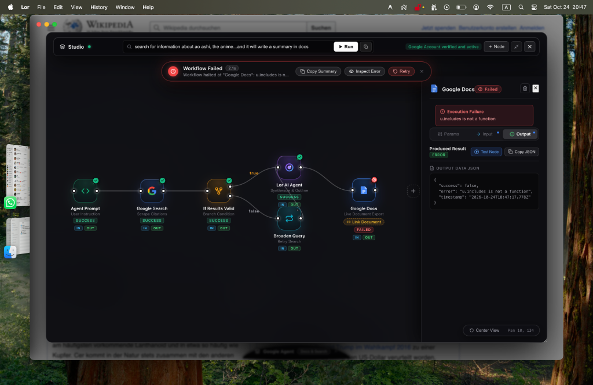
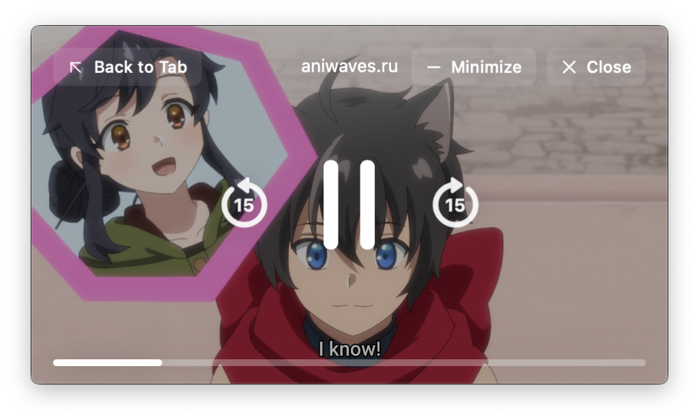

# Lor Browser

<div align="center">

<br>


# Lor
### The Autonomous Liquid Glass &amp; Monochrome Obsidian Browser

A minimalist desktop browser built with Electron 33, TypeScript, React 18, and native macOS AppKit WKWebView, combining contextual spaces with autonomous visual AI workflows (LorFlow) and a pure monochrome aesthetic.

<br>

[](https://github.com/tylertzm/lor-browser/releases)
[](https://github.com/tylertzm/lor-browser/releases)
[](docs/ARCHITECTURE.md)
[](https://tylertzm.github.io/lor-browser/)

<br>

[**Website**](https://tylertzm.github.io/lor-browser/) • [**Download macOS (.dmg)**](https://github.com/tylertzm/lor-browser/releases) • [**GitHub Releases**](https://github.com/tylertzm/lor-browser/releases) • [**Architecture Specs**](docs/ARCHITECTURE.md) • [**Report Bug**](https://github.com/tylertzm/lor-browser/issues)

<br>


</div>

---

## The Vision of Lor

Modern commercial web browsers have devolved into cluttered, tracking-heavy application launchers dominated by telemetry, intrusive notifications, and distraction.

**Lor is built from first principles for deep work, research, and autonomous agency:**
1. **Pure Monochrome Obsidian Hierarchy**: Zero saturated brand distractions, rainbow badges, or garish popups. Pure black canvas (`#000000`), carbon panels (`#0a0a0c`), and high-contrast typography engineered for total cognitive focus.
2. **LorFlow Autonomous Visual Studio**: A node-graph automation studio that allows autonomous agents to execute multi-turn web research, synthesize complex findings, and live-export directly into formatted Google Docs.
3. **Internal MCP Vibe-Coding**: Control, construct, and modify browser workflows using natural language via an embedded Model Context Protocol (MCP) bridge directly in the right AI chat tab.
4. **24-Hour Continuous Rollback**: Automatic snapshots saved before every mutation so you can revert any workflow state up to one day back.
5. **Dual-Engine Architecture**: Hardened Electron 33 desktop shell paired with an ultra-light native macOS AppKit / WKWebView core.

---

## Architectural System Overview

Lor's modular architecture separates the isolated UI canvas from the autonomous workflow execution engine and external cloud services:

<div align="center">

[](docs/ARCHITECTURE.md)

*Detailed hand-drawn architectural specification available in [docs/ARCHITECTURE.md](docs/ARCHITECTURE.md).*

</div>

---

## Visual Highlights

<div align="center">

| LorFlow Autonomous Studio | Visual Directed Node Canvas |
| :---: | :---: |
|  |  |

| Spaces & Navigation | Onboarding Prologue |
| :---: | :---: |
|  |  |

</div>

---

## Core Innovations

### 1. LorFlow Autonomous Studio & Self-Healing
- **Visual Directed Graph**: Build multi-step research and data pipelines connecting Prompt triggers, Google Search scrapers, Gemini synthesis, conditional branch logic, reiteration loops, and Google Docs export.
- **Fix with Lor in Chat**: When a node fails, one click transmits complete execution context to the right AI assistant to explain root cause and apply auto-repairs directly.
- **Autonomous Convergence**: Define satisfaction criteria and let the agent reiterate autonomously until the research goal is achieved.
- **Bottom 2% Lunar Crescent Trigger**: A solid crescent trigger at the bottom 2% of the display that charges its circumference on cursor dwell to launch the studio.

### 2. Conversational Vibe-Coding (Internal MCP)
- The right AI Assistant is wired directly to `LorFlowMCP`, an internal Model Context Protocol provider.
- Say *"Add a search node for quantum computing and connect it to Google Docs"* and watch the canvas wire itself in real time.
- Request rollbacks (*"Revert to the state from 10 minutes ago"*) or query execution state conversantly.

### 3. 24-Hour Continuous Versioning
- Full state snapshots recorded automatically prior to any workflow edits.
- Toolbar history dropdown displays relative timestamps (*Just now*, *5m ago*, *2h ago*), node counts, and one-click rollback buttons.
- Prunes entries older than 24 hours to keep client-side storage lightweight.

### 4. 15% Edge Peek Navigation
- Press **`Cmd + S`** or click **`[|]`** to collapse the sidebar into borderless web immersion.
- **Hover to Peek**: Move your cursor within the **left 15% edge of your display** to slide the navigation bar open instantly.
- Toggle the lock icon while peeking to pin the sidebar permanently.

### 5. Semantic Tab Tidy & Tab Vault
- Clean tab clutter with one click. Automatically clusters open tabs into categorized buckets (`DEV & TECH`, `RESEARCH & DOCS`, `COMMUNICATIONS`, `MEDIA`, `GENERAL`).
- Stash inactive tabs into the local **Tab Vault** to keep memory usage minimal.

---

## Installation & Releases

### macOS (Apple Silicon M1/M2/M3/M4)
Download the latest DMG from [GitHub Releases](https://github.com/tylertzm/lor-browser/releases):

1. Open `Lor-0.2.0-arm64.dmg`.
2. Drag `Lor.app` into **Applications**.
3. If macOS Gatekeeper alerts on first launch for unnotarized builds, run:
   ```bash
   xattr -cr /Applications/Lor.app
   ```
   *(Or navigate to System Settings -> Privacy & Security -> Click "Open Anyway".)*

---

## Development & Build Commands

```bash
# Clone repository
git clone https://github.com/tylertzm/lor-browser.git
cd lor-browser/arc-browser

# Install dependencies
npm install

# Run development mode
npm run dev

# Build production bundle
npm run build

# Package macOS DMG / Distributable
npm run package
```

---

## Security & Privacy Standards

- **Hardened Sandboxing**: `contextIsolation: true`, `nodeIntegration: false`, zero direct Node access from webviews.
- **Anti-Bot Cloaking**: Preload scripts sanitize navigator properties to protect against automated fingerprinting.
- **Zero Telemetry**: All history, tab vaults, and workflow snapshots remain strictly stored on your local device.
