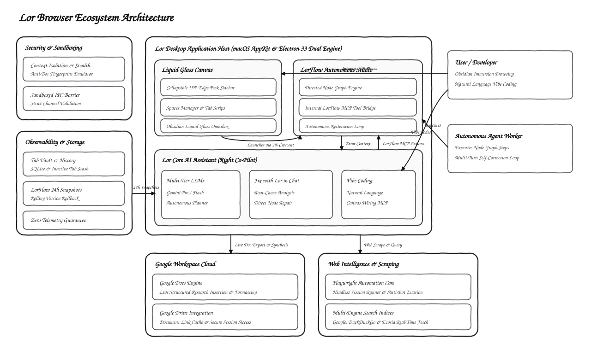

# Lor Browser — System Architecture & Design Specification

> A high-performance, minimalist desktop browser engineered with a pure monochrome obsidian aesthetic, dual-core native runtime, autonomous visual workflows (LorFlow), and sandboxed AI co-pilots.

---

## 1. Architectural System Diagram

The following hand-drawn architectural diagram depicts the major subsystems, interaction barriers, communication channels, and external cloud integrations across Lor Browser:

---

## 2. Core Subsystems

### A. Lor Desktop Application Host (Dual-Engine Core)
Lor utilizes a hybrid architecture combining a native macOS AppKit shell with an Electron 33 runtime:
- **macOS Native Core (`Lor/`)**: Pure Swift + AppKit + WKWebView implementation for ultra-low memory overhead and fluid native macOS gestures.
- **Electron Desktop Shell (`arc-browser/`)**: React 18 + TypeScript + Vite running inside a hardened Electron 33 environment.
- **Sandboxed IPC Bridge**: All renderer-to-main communication passes through strictly validated channels defined in `electron/preload.ts`. `contextIsolation` is permanently enforced with `nodeIntegration: false`.
- **Anti-Bot Stealth Layer**: Custom CDP emulation and navigator cloaking in `electron/stealthPreload.ts` protect against bot-detection profiling.

### B. Obsidian Liquid Glass Canvas
- **Collapsible Navigation**: Borderless immersion with a collapsible sidebar toggled via `Cmd + S`.
- **15% Screen Edge Peek**: Hovering cursor along the left 15% of the display slides the sidebar open smoothly.
- **Spaces & Tab Management**: Dedicated contextual spaces with vertical tab strips and tab vaults for stashing inactive tabs.
- **Bottom 2% Crescent Trigger**: Sleek lunar crescent trigger docked at the bottom 2% of the display that charges on dwell to summon LorFlow.

### C. LorFlow Autonomous Studio
- **Visual Node Graph**: Interactive canvas for directed logic graphs (Prompt Trigger, Google Search, Gemini AI Synthesis, Logic Branching, Reiteration Loops, Google Docs Export).
- **Internal MCP Tool Bridge (`lorflowMcp.ts`)**: Embedded Model Context Protocol (MCP) provider allowing the AI Assistant to programmatically inspect, modify, and wire workflows in real time.
- **24-Hour Continuous Versioning**: Automatic state snapshots recorded before mutations with rollback retention up to 24 hours.
- **Autonomous Goal Convergence**: Iterative feedback loop comparing research depth against satisfaction criteria until convergence is reached.

### D. Lor Core AI Assistant
- **Multi-Tier Model Routing**: Support for Gemini Pro, Gemini Flash, and Flash-Lite models with user-configurable API keys.
- **Fix with Lor in Chat**: Automated diagnostic pipeline receiving failed node contexts, explaining root causes, and executing auto-repairs.
- **Conversational Vibe-Coding**: Natural language workflow construction and schema manipulation directly from chat.

### E. Integrations & External Services
- **Google Workspace Cloud**: Direct OAuth2 authentication, live Google Docs creation, and automated heading/paragraph formatting.
- **Web Intelligence**: Playwright session automation paired with real-time multi-engine search scraping (Google, DuckDuckGo, Ecosia).
- **Zero-Telemetry Local Storage**: Client-side storage for history, tab vaults, and cached Google Docs links with no external telemetry tracking.
